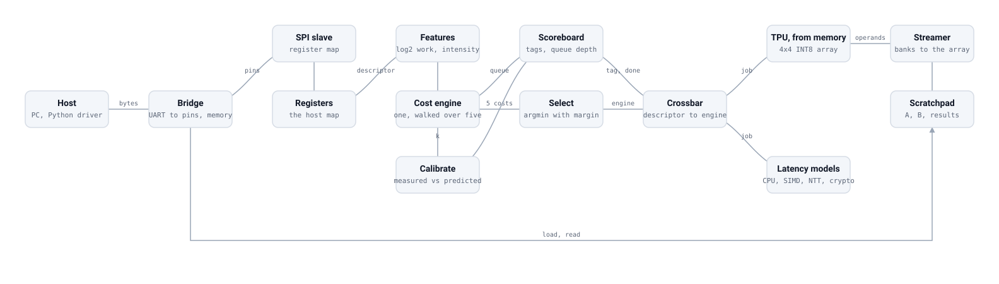

# HYDRA-130

**Adaptive hardware scheduling and accelerator research for FPGA and SkyWater 130 nm.**

HYDRA pairs a cost-based hardware scheduler with compute and security blocks
developed alongside it. The scheduler predicts how long each engine would take
a piece of work, sends the work to the cheapest engine, measures what really
happened and corrects its own model. This repository holds the RTL, the
reference models, the integration harnesses, the host tools and the
engineering records. **What runs depends on the build you choose.**

[Getting started](docs/GETTING_STARTED.md) ·
[Capability matrix](docs/verification/capability-matrix.md) ·
[Architecture](docs/ARCHITECTURE.md) ·
[FPGA bring-up](docs/FPGA_BRINGUP.md) ·
[Security scope](docs/security/threat-model.md) ·
[Audit closure](docs/audit/second-audit-closure.md) ·
[Tiny Tapeout tile](https://github.com/Normansrule/tinytapeout-hydra)

> **Development status.** This is not yet a complete or board-qualified
> CPU/GPU/TPU system. No image has been run on a physical board. The public
> ULX3S build is the scheduler and its serial bridge. No CPU or GPU is
> integrated. Fully homomorphic encryption (FHE) and sequestered execution
> (SE) are written specifications, and the host driver refuses jobs that ask
> for them. The separate Tiny Tapeout chip is the scheduler alone.

<p align="center">
  
</p>

## What works now

| part | what it is | evidence reached | how to check |
|---|---|---|---|
| Scheduler (Mathematical Operation MUX, MOM) | cost model over five engine slots, tags, self-calibration | simulated against models; proofs on its interfaces; the tile version has been hardened (v3.4, 2026-10-17) | `make systile`, `make cost-cal`, `make tile` |
| TPU | 4×4 INT8 systolic array, also fed from scratchpad memory | simulated against an independent model; mutation-tested | `make tpu`, `make dma` |
| Vector unit | 4 lanes × 32-bit integer. **Not a GPU** | simulated; mutation-tested | `make simd`, `make dma-simd` |
| Number-theoretic transform (NTT) butterflies | 4 Barrett butterflies at q = 3329, 8380417, 12289. **Not a transform, not FHE** | simulated at all three moduli, core and memory path | `make ntt-moduli` |
| Security IP | key vault, mailbox, SHA-256, measurement register, security instructions | simulated and proved **as separate blocks**; not integrated into any build | `make keyvault sha256-stream pcr xsec` |
| CPU, GPU | Sixfold (64-bit RISC-V) and Pixelstorm (single-instruction, multiple-thread, SIMT) | separate repositories; **not integrated** | [plan](docs/architecture/heterogeneous-system.md) |
| FHE, SE, mode switching | specifications only | **UNSUPPORTED** in every build | [FHE](docs/security/fhe-profile.md), [SE](docs/security/se-contract.md), [transition](docs/security/mode-transition.md) |

Each of these levels is defined in the
[capability matrix](docs/verification/capability-matrix.md), which also
records what is missing.

## As built: the memory-fed FPGA image



This figure is generated for one named build, `plans/ecp5-evn-mem.yaml`. Every
block in it is instantiated in that build's own sources, and the generator
refuses to draw one that is not. In text: a host program talks over a serial
bridge to an SPI register map. The register map feeds the scheduler, which is
features, one shared cost engine, select, scoreboard and calibration. The
scheduler's choice goes through a crossbar, either to the TPU (fed from
scratchpad banks by a streamer) or to latency models standing in for the CPU,
vector, NTT and crypto slots. The other blocks are listed as an
[IP library and a roadmap](docs/ARCHITECTURE.md), kept apart from this view on
purpose.

## Start with a simulation

```bash
cd ~/src && git clone --recurse-submodules https://github.com/Normansrule/hydra-skywater130.git && cd hydra-skywater130 && ./scripts/bootstrap-ubuntu.sh && make bootstrap && make cost-cal tpu systile harness
```

Read `scripts/bootstrap-ubuntu.sh` first: it installs packages with `sudo`.
[Getting started](docs/GETTING_STARTED.md) explains each step and the line
each check must print. `make verify` runs the whole suite. It does not
program a board, and it does not sign off a chip.

## Choose a target

| target | what it is for | start with |
|---|---|---|
| Simulation | scheduling, arithmetic and interface behaviour | [Getting started](docs/GETTING_STARTED.md) |
| ULX3S-85F scheduler image | the host link and the scheduler in FPGA logic | [bring-up procedure](docs/bringup/ulx3s-85f.md) (not yet run on a board) |
| ECP5 engine images | real arithmetic and memory integration | [FPGA bring-up](docs/FPGA_BRINGUP.md); pick the exact board and image |
| Basys 3 | board self-test; a HYDRA image with serial and JTAG host paths (simulated, not yet built with Vivado) | [Basys 3 guide](docs/FPGA_BASYS3.md) |
| SkyWater OpenFrame RTL | pad-level integration around the scheduler | `sky130/rtl/hydra_openframe_top.sv` (never hardened) |
| Tiny Tapeout | the scheduler-only research chip | [its repository](https://github.com/Normansrule/tinytapeout-hydra) |

An image built for one board is not safe to program onto another. Check the
device, package, board revision, clock, constraints and jumpers first.

## How scheduling works

A 128-bit work descriptor names an operation, a data type and dimensions. The
scheduler derives features from it (log₂ of the work and of its arithmetic
intensity). Then one cost engine evaluates each eligible engine in turn, two
cycles each, and the cheapest wins; an engine that cannot do the operation
or the data type is excluded first. When the work completes, the measured
time moves that engine's calibration factor one step toward the truth.

The cost is a model, not a power measurement. Calibration has a known limit:
an engine the scheduler stops choosing is never measured again, so it does
not recover from a transient slowdown. `make systile` asserts this
behaviour on purpose, so that a change to it cannot go in silently.

## Verification and evidence

| evidence | establishes | does not establish |
|---|---|---|
| reference-model simulation | agreement on the tested inputs and configuration | exhaustive correctness |
| formal proof | the named property under its stated assumptions | anything wider |
| mutation test | that the named deliberate breaks are caught | that every defect would be |
| FPGA place and route | mapping and timing for that device and those constraints | that a board works |
| board test | measured behaviour of one image on one board (none yet) | other configurations |
| ASIC reports | the named checks on one exact layout (the tile, v3.4) | fabricated silicon, or the full chip |

Every simulation runs through `scripts/runsim.sh`, so a failure cannot pass
quietly. `scripts/ci_selftest.sh` breaks the design on purpose and requires
each break to fail the build. The latest archived runs, with tool versions
and the failing "before" logs for each fix, are in
`reports/lint-harden-2026-10-13/`, `reports/audit-sky130-2026-10-12/` and
`reports/audit2-2026-10-11/`. The October 10, 2026 CI run
reported a successful ULX3S place and route for commit `d174416`. That is
build evidence, not a board test, and it predates the baud-rate fix.

Tile timing history is in [timing.json](docs/timing.json), with each run's
target and date. Do not carry tile area or timing over to the parent system.

## Documentation

| need | document |
|---|---|
| your first simulation | [Getting started](docs/GETTING_STARTED.md) |
| what each part has been shown to do | [Capability matrix](docs/verification/capability-matrix.md) |
| as-built views, IP library, roadmap | [Architecture](docs/ARCHITECTURE.md) |
| datasheets (preliminary) | [scheduler tile](docs/datasheets/HYDRA-TT-A.md), [FPGA images](docs/datasheets/HYDRA-FPGA-EVAL.md) |
| security scope | [threat model](docs/security/threat-model.md), [security plan](docs/SECURITY_PLAN.md) |
| audit findings and their status | [closure table](docs/audit/second-audit-closure.md) |
| tapeout preparation | [Release and tapeout preparation](docs/FIRST_TRY.md) |
| design history, measured results, reasoning | [Engineering notes](docs/ENGINEERING_NOTES.md) (the previous README, in full) |
| where the work stands and what is next | [Handoff](docs/HANDOFF.md) |
| the project page | `docs/site/index.html`, a single self-contained file to open locally. It is not deployed |

## Development priorities

1. Run the ULX3S scheduler image on a real board and record the result
   ([procedure](docs/bringup/ulx3s-85f.md)).
2. Bring the tile's slew warnings to 0. The v3.4 harden at 4×4 signed off
   clean with 21 / 21 gate-level tests, but left 4,197 slew and 30
   capacitance warnings at the slow corner, all on `buf_1` fanout buffers.
3. Integrate the GPU, then the CPU, behind one versioned job interface.
4. FHE, then SE, each against its written contract.

Contributions should name the affected build and parameters, include a test
that fails without the change, and update the generated evidence. Please
don't weaken a test to get a green badge back.

## Licence and provenance

Apache 2.0 (see `LICENSE`). Board pin files are not redistributed: each board
file records its source URL and SHA-256, and `tools/import_boards.py` fetches
them (see `NOTICE`). The Tiny Tapeout tile is a submodule with its own licence.
