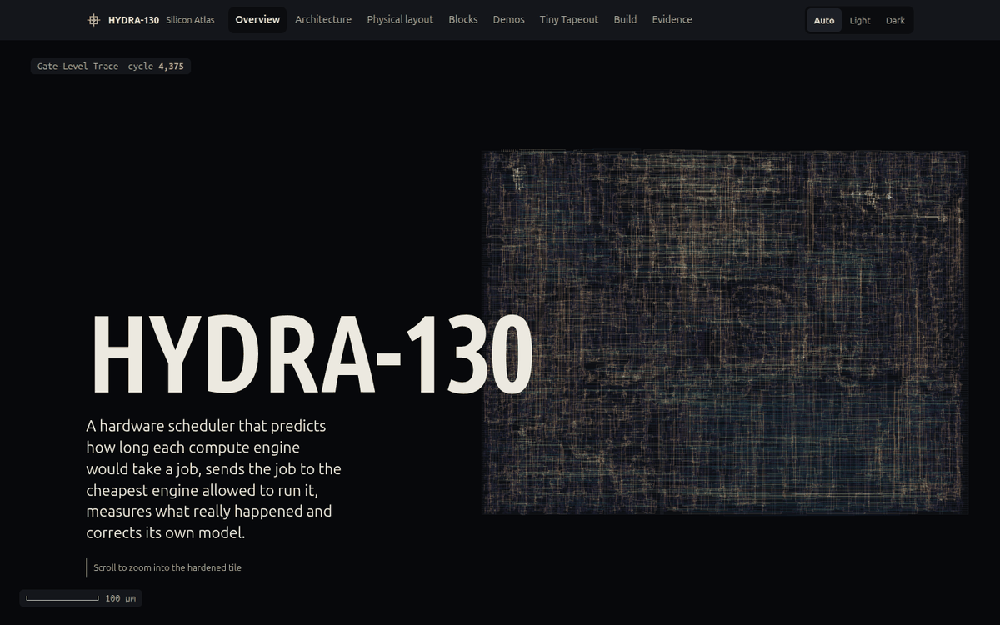
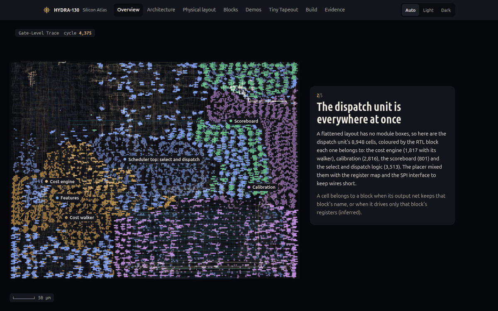
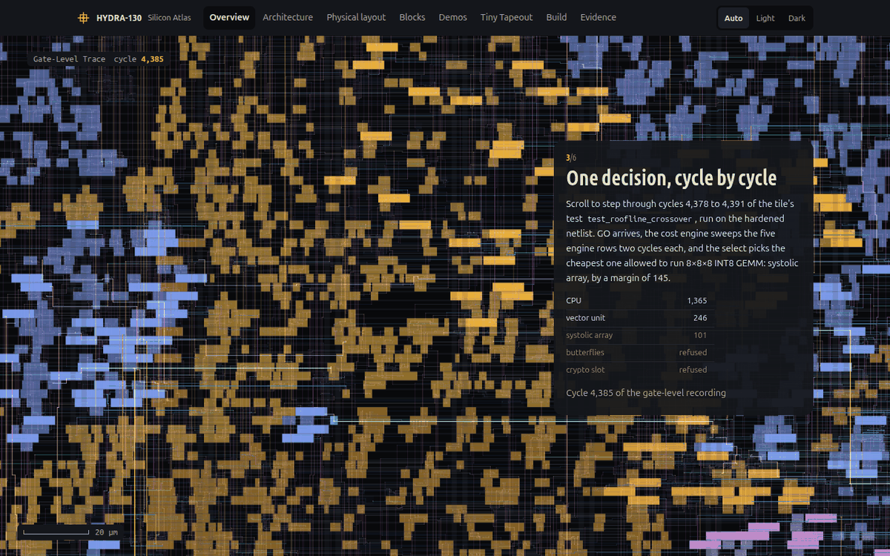
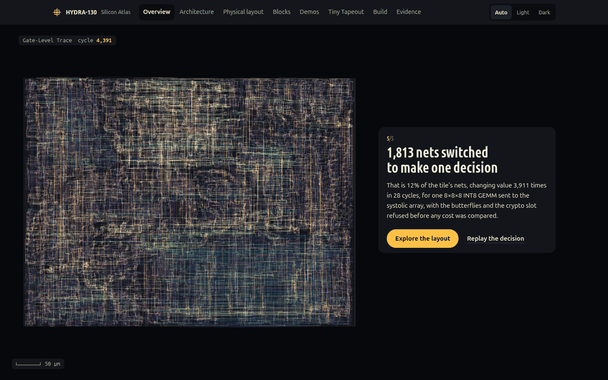
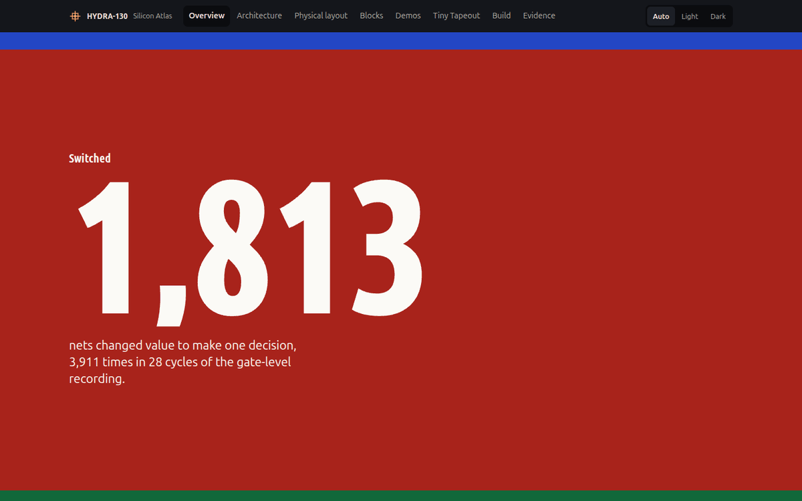
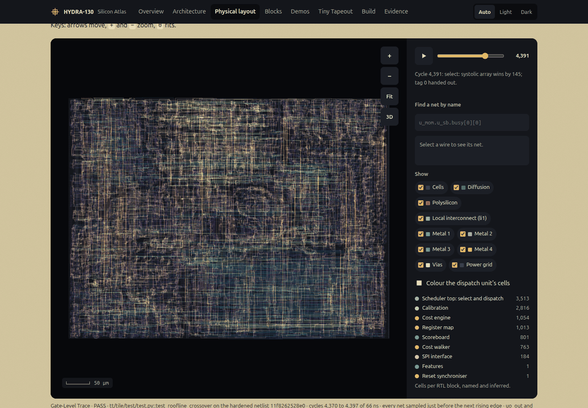
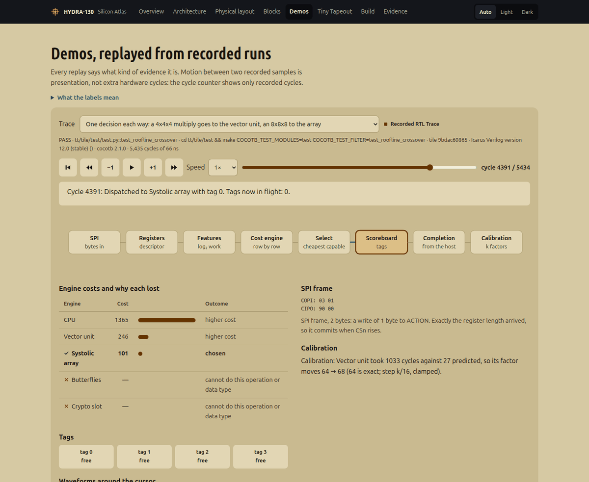
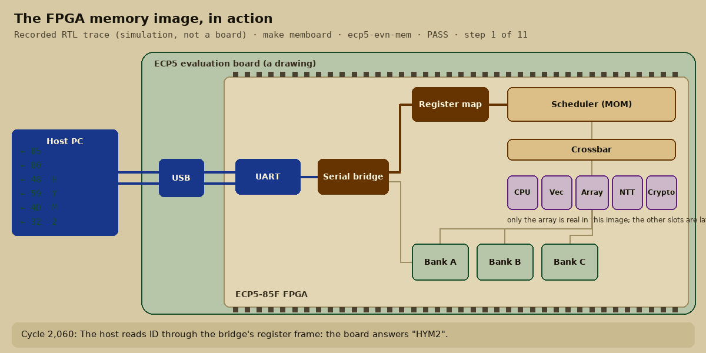

# HYDRA-130

HYDRA-130 is a hardware scheduler for chips that carry more than one kind of compute engine. You hand it a job
(say, an 8×8×8 matrix multiply), it predicts how long every engine would take, sends the job to the cheapest
engine that is allowed to run it, then measures what really happened and corrects its own model, with no
firmware in the loop. This repository holds the register-transfer level (RTL) design, the engines it schedules,
the testbenches and proofs, the field-programmable gate array (FPGA) images and the tools that build the project
page. It's for people who design or study heterogeneous hardware: anyone curious how a scheduler can decide
between a central processing unit (CPU), a graphics processing unit (GPU) and a tensor processing unit (TPU) in
hardware, and how far each claim here has actually been checked.

[Zoom into the tile](https://normansrule.github.io/hydra-skywater130/) ·
[Explore the layout](https://normansrule.github.io/hydra-skywater130/#layout) ·
[Replay a decision](https://normansrule.github.io/hydra-skywater130/#demos/crossover/4391) ·
[Set it up](#setup-and-usage) ·
[Evidence](#verification-and-evidence) ·
[The Tiny Tapeout tile](https://github.com/Normansrule/tinytapeout-hydra) ·
Maintained by [@Normansrule](https://github.com/Normansrule)

> **Where things stand, by revision.** The **Tiny Tapeout tile** is the scheduler alone; its v3.10 harden has a
> clean sign-off record from one LibreLane run, which is not fabricated or tested silicon. The **SkyWater 130
> OpenFrame chip** top holds the scheduler, a pad multiplexer and the serial peripheral interface (SPI); it is
> simulated through its pads and has never been hardened. The CPU, GPU and TPU slots run in **system-tile
> simulations**, not in that top. **No FPGA image has run on a board yet.** The security blocks are checked IP
> that no build instantiates. Fully homomorphic encryption (FHE) and sequestered execution (SE) are
> specifications, and the host driver refuses jobs that ask for them.

<p align="center">
<picture>
  <source media="(prefers-color-scheme: dark)" srcset="docs/img/hero.dark.svg">
  
</picture>
</p>

## Key features

- **A scheduler that checks its own guesses.** A roofline cost model (compute time against operand traffic, plus
  queue depth and an energy term) prices every engine; one shared cost engine walks the engine rows two cycles
  each; the scoreboard hands out tags; each completion moves that engine's calibration factor toward the
  measured time.
- **Eligibility before cost.** An engine that can't perform the operation or represent the data type is
  refused before any cost is compared, and ABI version 2 (the job header's application binary interface) can
  force an engine or refuse a mode, with no silent fallback.
- **Real engines behind it.** A 4×4 INT8 systolic array (the TPU), a 4-lane vector unit, number-theoretic
  transform (NTT) butterflies at three moduli, the Pixelstorm GPU and the Sixfold 64-bit RISC-V CPU, each checked
  against an independent model.
- **Three targets, kept apart.** The scheduler-only Tiny Tapeout tile, the SkyWater 130 OpenFrame chip, and ten
  FPGA build plans. Nothing proved for one is claimed for another.
- **The Silicon Atlas.** A self-contained project page built from the repository itself. It opens on the tile's
  real routed layout (70,901 cells and 14,608 nets from the v3.10 harden, each cell drawn from the process design
  kit's own layout of its type) and zooms in as you scroll while one dispatch decision plays on it: every wire
  glows while its net is high in a gate-level simulation of the hardened netlist, in the manner of
  [Visual 6502](http://www.visual6502.org/). Behind that: what each of 18 builds actually instantiates (read from
  the compiler), 34 block cards written from the RTL with file and line citations, and 14 replays of passing
  tests you can step through cycle by cycle.
- **Honest evidence.** Every simulation runs through `scripts/runsim.sh`, deliberate breaks must be caught,
  every number on the page comes from tool output, and `make site-check` fails the moment the page is older than
  the sources it describes.

## Screenshots

The atlas opens on the hardened tile and zooms in as you scroll. These are its six steps, shot from the page
itself (the die is always drawn dark, like a mask; the rest of the page follows your light or dark setting):

<picture>
  <source media="(prefers-color-scheme: dark)" srcset="docs/img/atlas-story.dark.png">
  
</picture>

<picture>
  <source media="(prefers-color-scheme: dark)" srcset="docs/img/atlas-dispatch.dark.png">
  
</picture>

<picture>
  <source media="(prefers-color-scheme: dark)" srcset="docs/img/atlas-decision.dark.png">
  
</picture>

<picture>
  <source media="(prefers-color-scheme: dark)" srcset="docs/img/atlas-cells.dark.png">
  
</picture>

<picture>
  <source media="(prefers-color-scheme: dark)" srcset="docs/img/atlas-exploded.dark.png">
  
</picture>

<picture>
  <source media="(prefers-color-scheme: dark)" srcset="docs/img/atlas-switched.dark.png">
  
</picture>

After the story, one number per screen, each on a block of colour, its fill exposed as you scroll to it; every
number is read from the layout, the gate-level recording or the FPGA simulation:

<picture>
  <source media="(prefers-color-scheme: dark)" srcset="docs/img/atlas-numbers.dark.png">
  
</picture>

The same layout is a free explorer on the [Physical layout](https://normansrule.github.io/hydra-skywater130/#layout)
tab: zoom from the whole tile to single transistors, pull the layers apart in 3D and turn them, step through the recorded cycles, switch layers on and off,
select a wire to name its net and the RTL block that drives it, or find a net by name.

<picture>
  <source media="(prefers-color-scheme: dark)" srcset="docs/img/atlas-layout.dark.png">
  
</picture>

Replaying one recorded decision, with the costs, the refused engines, the tags and the SPI bytes in step:

<picture>
  <source media="(prefers-color-scheme: dark)" srcset="docs/img/atlas-demo.dark.png">
  
</picture>

<picture>
  <source media="(prefers-color-scheme: dark)" srcset="docs/img/demo_dispatch.dark.gif">
  
</picture>

<picture>
  <source media="(prefers-color-scheme: dark)" srcset="docs/img/demo_array.dark.gif">
  
</picture>

The FPGA memory image in action. No HYDRA image has run on a board yet, so this is its RTL driven through the
serial port by its own testbench (`make memboard`) and replayed byte for byte: the host reads the ID ("HYM2"),
writes both operand banks, stages a descriptor and presses GO; the scheduler sends the job to the systolic array,
which streams both banks and writes bank C; then every result is read back. The board is a drawing, and the
place-and-route numbers beside it on the page come from `docs/metrics.json`.

<picture>
  <source media="(prefers-color-scheme: dark)" srcset="docs/img/demo_fpga.dark.gif">
  
</picture>

The frames are drawn from recorded runs of passing tests, not typed in. One more view: the
[logical architecture](docs/img/atlas-architecture.png) of any build.

## As built: one named build

<picture>
  <source media="(prefers-color-scheme: dark)" srcset="docs/img/architecture.dark.svg">
  
</picture>

This figure is generated for one build, `plans/ecp5-evn-mem.yaml`. Each box is a module the compiler elaborated
when that plan's sources were compiled (`tools/atlas_derive.py`), so a block that isn't instantiated can't be
drawn. In words: a host program talks over a serial port to a bridge, which drives the SPI register map and
loads the scratchpad; the register map feeds the scheduler; the decision goes through the crossbar either to the
systolic array, fed from scratchpad banks by a streamer, or to latency models standing in for the CPU, vector,
NTT and crypto slots.

## Setup and usage

You'll want WSL2 Ubuntu or a Linux machine. Read `scripts/bootstrap-ubuntu.sh` first: it installs packages with
`sudo`. Then clone, bootstrap and run a first handful of checks:

```bash
cd ~/src && git clone --recurse-submodules https://github.com/Normansrule/hydra-skywater130.git && cd hydra-skywater130 && ./scripts/bootstrap-ubuntu.sh && make bootstrap && make cost-cal tpu systile harness
```

The whole suite (simulations against independent models, formal proofs, lint, the tile's tests, the generated
figures and page). It doesn't program a board or sign off a chip:

```bash
cd ~/src/hydra-skywater130 && make verify
```

Open the atlas straight from disk (no server, no network):

```bash
cd ~/src/hydra-skywater130 && xdg-open docs/site/index.html
```

After you change RTL, re-derive the builds, re-record every trace from passing tests, and rebuild the page and
figures:

```bash
cd ~/src/hydra-skywater130 && make atlas && make readme-art && make site-check readme-check
```

After a new harden, extract its routed layout and record the gate-level decision that lights it (the run must be
built from the current `project.v`, and the recording's pins must equal the RTL trace in every cycle, or nothing
is written):

```bash
cd ~/src/hydra-skywater130 && make atlas-die RUN=$HOME/src/tinytapeout-hydra/runs/wokwi && make readme-shots
```

More: [Getting started](docs/GETTING_STARTED.md) explains each step and the line each check must print;
[Publish and test](docs/PUBLISH_AND_TEST.md) has every copy-paste command, the harden and the FPGA builds
included. An image built for one board is not safe to program onto another: check the device, package, board
revision, clock, constraints and jumpers first.

| target | what it's for | start with |
|---|---|---|
| Simulation | scheduling, arithmetic and interface behaviour | [Getting started](docs/GETTING_STARTED.md) |
| ULX3S-85F scheduler image | the host link and the scheduler in FPGA logic | [bring-up procedure](docs/bringup/ulx3s-85f.md) (not yet run on a board) |
| ECP5 engine images | real arithmetic and memory integration | [FPGA bring-up](docs/FPGA_BRINGUP.md); pick the exact board and image |
| Basys 3 | board self-test; a HYDRA image with serial and JTAG host paths (simulated, not yet built with Vivado) | [Basys 3 guide](docs/FPGA_BASYS3.md) |
| SkyWater OpenFrame RTL | pad-level integration around the scheduler | `sky130/rtl/hydra_openframe_top.sv` (never hardened) |
| Tiny Tapeout | the scheduler-only research chip | [its repository](https://github.com/Normansrule/tinytapeout-hydra) |

## What works now

| part | what it is | evidence reached | how to check |
|---|---|---|---|
| Scheduler (Mathematical Operation MUX, MOM) | cost model over five engine slots, tags, self-calibration | simulated against models; proofs on its interfaces; the tile version has been hardened (v3.10, 2026-10-18) | `make systile`, `make cost-cal`, `make tile` |
| TPU | 4×4 INT8 systolic array, also fed from scratchpad memory | simulated against an independent model; mutation-tested | `make tpu`, `make dma` |
| Vector unit | 4 lanes × 32-bit integer. **Not a GPU** | simulated; mutation-tested | `make simd`, `make dma-simd` |
| NTT butterflies | 4 Barrett butterflies at q = 3329, 8380417, 12289. **Not a transform, not FHE**; in no scheduler slot (the NTT slot is a latency model) | simulated at all three moduli, core and memory path | `make ntt-moduli` |
| Security IP | key vault, mailbox, SHA-256, measurement register, security instructions | proved and, except the key vault, simulated **as separate blocks**; in no build | `make keyvault sha256-stream pcr xsec` |
| GPU engine | Pixelstorm (single-instruction, multiple-thread, SIMT), 2 multiprocessors × 4 warps × 8 lanes, on a HYDRA scratchpad bank | simulated: 14 real kernels leave the bank exactly as Pixelstorm's own model does; malformed launches refused; synthesized for ECP5. The **sixth slot of the system tile**, in simulation: an INT32 matrix multiply is costed and sent to it, INT8 kept off it | `make gpu`, `make systile-gpu` |
| ABI version 2 | a 64-bit header in front of each descriptor: security mode, engine policy (AUTO or a forced engine), context and epoch | simulated in the system tile, against an independent model and end to end: eligibility applied before cost, forced engines honoured, FHE/SE and stale contexts refused with no fallback; proved | `make abi-v2 systile-abi` |
| CPU | Sixfold (64-bit RISC-V, 6 stages), in a HYDRA wrapper with a load port and a done/halt handshake | simulated: all 24 Sixfold programs give the registers, TOHOST value and cycle count of Sixfold's own model; the system tile's CPU slot, chosen for scalar work and kept off the GPU. A cached build (Sixfold's caches over block memory) matches the cached model on every program and maps to ECP5 cells (**synthesis only**, not placed); the flat 64 KiB build is simulation only | `make cpu`, `make systile-cpu`, `make cpu-cached cpu-synth` |
| FHE, SE, mode switching | specifications only | **UNSUPPORTED** in every build | [FHE](docs/security/fhe-profile.md), [SE](docs/security/se-contract.md), [transition](docs/security/mode-transition.md) |

Each of these levels is defined in the [capability matrix](docs/verification/capability-matrix.md), which also
records what is missing.

<picture>
  <source media="(prefers-color-scheme: dark)" srcset="docs/img/progress.dark.svg">
  
</picture>

## Project structure

```text
hydra-skywater130/
├── mom/          the scheduler: SPI slave, register map, features, cost engine, select, scoreboard, calibration
├── common/       shared RTL: the dispatch crossbar, pad multiplexer, reset synchroniser
├── engines/      arithmetic engines: tpu/ (systolic array), simd/ (vector lanes), ntt/ (Barrett butterflies)
├── mem/          scratchpad banks and the streamers that feed engines from them
├── sys/          the system tile that wires scheduler, crossbar and engines; ABI version 2; GPU and CPU wrappers
├── sec/          security IP: key vault, mailbox, SHA-256, measurement register (checked, in no build)
├── isa/          the security-instruction unit (Zknh plus a custom extension)
├── dbg/          the JTAG test access port and its clock-domain bridge
├── sky130/       the SkyWater 130 OpenFrame chip top and its pad-level testbench
├── fpga/         board tops, the serial bridge, constraints and per-board build folders
├── plans/        one YAML build plan per FPGA image
├── ext/          submodules: Pixelstorm GPU, Sixfold CPU
├── tt/           the Tiny Tapeout tile (submodule tt/tile) and its formal checks
├── tools/        generators (atlas, README figures, page), host driver, timing and harden tools
├── scripts/      runsim.sh, bootstrap, release, harden ladder, gate-level runs
├── reports/      archived runs: lint, harden logs, audits
└── docs/
    ├── site/     the Silicon Atlas (generated; open index.html)
    ├── atlas/    the atlas's data: blocks, cards, derived builds, recorded traces, layout map,
    │             the routed layout and its gate-level recording (die*.json, die*.bin), the FPGA
    │             image's serial-port run (fpga.json), the two typefaces
    ├── img/      README figures, each in light (.svg) and dark (.dark.svg)
    └── ...       capability matrix, architecture, security scope, bring-up, handoff
```

## Design

The concept is the **mask room**. A photolithography room is lit by an amber safelight, because white light would
expose the resist, and the mask itself is chrome on quartz. So the light theme is the room (warm, nearly
monochrome, with colour kept for things that mean something), the dark theme is the mask, and the die view is
always drawn as a mask, whichever theme you're in.

- **Every colour is a mask layer.** The colours that carry meaning are sky130 layer colours: metal-1 blue for data
  and requests moving, safelight amber for control and decisions, metal-2 violet for compute, diffusion green for
  memory, polysilicon red for security IP. Each comes with a drawn shape (a triangle, a diamond, a square,
  stacked bars, a shield), so colour is never the only cue. In the die view the layers keep their own colours,
  and a wire that is high glows amber.
- **One family, two widths.** Ubuntu Sans condensed for headings, at normal width for reading, and Ubuntu Sans
  Mono only for code, signal names and bytes; six text sizes. Both are embedded as small subsets (Ubuntu Font
  Licence, in `docs/atlas/fonts/`), so the page fetches nothing.
- **A reticle for a frame.** The die sits full-bleed behind the story, framed by four alignment marks and a scale
  bar that always tells the truth about size; the step cards ride beside it. Everywhere else, surfaces are
  separated by tone, not lines.
- **Motion with physics, and only where it informs.** The camera rides a critically damped spring, so it settles
  without overshoot, and the same spring tilts the layout into an exploded stack of its real layers; a net that switches flashes and fades with an afterglow (its glow rises with a 45 ms time
  constant and falls with a 260 ms one; the flash fades with 420 ms); a step card arrives with a short exposure wipe, and a big number's fill is exposed the same way as you scroll
  to it; a band of real figures scrolls between sections; the FPGA board leans toward your pointer; controls answer a
  press. Scrolling through
  step 3 scrubs the recorded cycles. With reduced motion on, the camera jumps, nothing flashes, nothing wipes and the band stands still.
- **The data is the picture.** Every rectangle is from the harden's DEF file, every cell's insides from the
  process design kit's GDS, and every glowing wire from a gate-level run of that exact netlist whose pins equal the
  RTL trace in every cycle. A logical box never claims a die position.
- **It holds up when things go wrong.** The layout shows a "developing the mask" state while it unpacks, a plain
  explanation with Tiny Tapeout's still render if WebGL 2 or decompression is missing, and a blocked-by-evidence
  note if no layout was extracted. It works from 320 px to wide desktops, from the keyboard (the explorer takes
  arrows, `+`, `−` and `0`), in light and dark, and without JavaScript, where the steps, the still render and the
  layout as text remain.

The generators own all of this: `tools/atlas_theme.py` (palettes, light, dark and the die), `tools/atlas_site.py`
(the page and the die renderer), `tools/atlas_die.py` (the layout and the gate-level recording),
`tools/atlas_fonts.py` (the typefaces), `tools/gen_readme_*.py` (figures, GIFs, films and these screenshots).
Edit those, never the generated files.

## Verification and evidence

| evidence | establishes | does not establish |
|---|---|---|
| reference-model simulation | agreement on the tested inputs and configuration | exhaustive correctness |
| formal proof | the named property under its stated assumptions | anything wider |
| mutation test | that the named deliberate breaks are caught | that every defect would be |
| recorded trace (atlas) | what one passing run did, cycle by cycle, on hashed sources | anything that run didn't exercise |
| FPGA place and route | mapping and timing for that device and those constraints | that a board works |
| board test | measured behaviour of one image on one board (none yet) | other configurations |
| ASIC reports | the named checks on one exact layout (the tile, v3.10) | fabricated silicon, or the full chip |

`scripts/ci_selftest.sh` breaks the design on purpose and requires each break to fail the build. Every atlas trace
records the test, command, commits, tool versions and the hash of each source it ran. Places where the documents
and the RTL disagree, found while writing the atlas, are listed on its
[Evidence tab](https://normansrule.github.io/hydra-skywater130/#evidence). Tile timing history is in
[timing.json](docs/timing.json), with each run's target and date; don't carry tile area or timing over to the
parent system.

## Documentation

| need | document |
|---|---|
| the interactive atlas | [Silicon Atlas](https://normansrule.github.io/hydra-skywater130/) (or `docs/site/index.html` from disk); its data and tools: [docs/atlas](docs/atlas/README.md) |
| your first simulation | [Getting started](docs/GETTING_STARTED.md) |
| commands to test and publish | [Publish and test](docs/PUBLISH_AND_TEST.md) |
| what each part has been shown to do | [Capability matrix](docs/verification/capability-matrix.md) |
| as-built views, IP library, roadmap | [Architecture](docs/ARCHITECTURE.md) |
| datasheets (preliminary) | [scheduler tile](docs/datasheets/HYDRA-TT-A.md), [FPGA images](docs/datasheets/HYDRA-FPGA-EVAL.md) |
| security scope | [threat model](docs/security/threat-model.md), [security plan](docs/SECURITY_PLAN.md) |
| audit findings and their status | [closure table](docs/audit/second-audit-closure.md) |
| design history and reasoning | [Engineering notes](docs/ENGINEERING_NOTES.md) |
| where the work stands and what's next | [Handoff](docs/HANDOFF.md) |
| who maintains it | [MAINTAINERS.md](MAINTAINERS.md) |

## What's next

1. Run the ULX3S scheduler image on a real board and record the result
   ([procedure](docs/bringup/ulx3s-85f.md)).
2. Bring the tile's slew warnings to 0. The v3.10 harden signed off clean with 22 / 22 gate-level tests but left
   1,230 slew warnings at the slowest corner; the count moves with placement, not only with settings.
3. Move the CPU, GPU and TPU from the system tile into the OpenFrame chip top, then harden the chip.
4. FHE, then SE, each against its written contract.

Contributions should name the affected build and parameters, include a test that fails without the change, and
update the generated evidence. Please don't weaken a test to get a green badge back.

## Licence, provenance and maintainer

Apache 2.0 (see `LICENSE`). Board pin files are not redistributed: each board file records its source URL and
SHA-256, and `tools/import_boards.py` fetches them (see `NOTICE`). The Tiny Tapeout tile, Pixelstorm and Sixfold
are submodules with their own licences. Maintained by [@Normansrule](https://github.com/Normansrule)
([MAINTAINERS.md](MAINTAINERS.md)).
