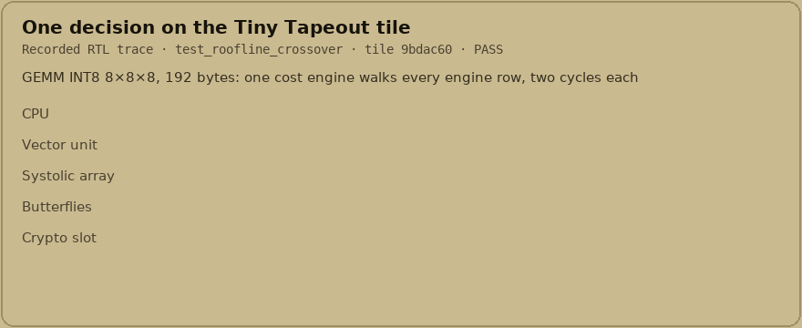
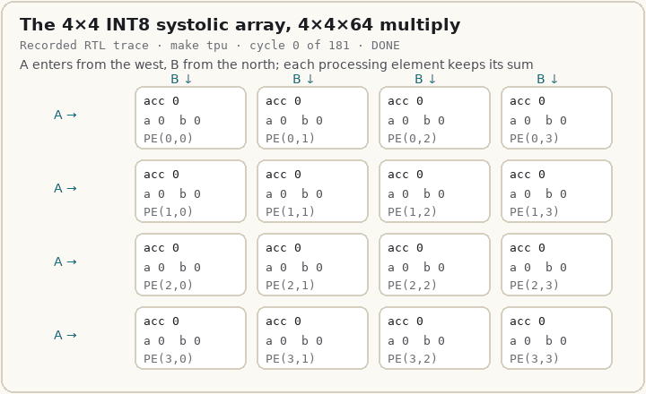
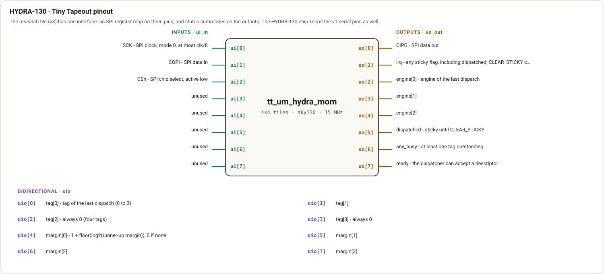

# HYDRA-130

**A hardware scheduler that predicts how long each compute engine would take a job, sends the job to the cheapest
engine allowed to run it, measures what really happened and corrects its own model.**

[Explore the architecture](https://normansrule.github.io/hydra-skywater130/#architecture) ·
[Run a demo](https://normansrule.github.io/hydra-skywater130/#demos) ·
[Build it](#start-with-a-simulation) ·
[Evidence](#verification-and-evidence) ·
[Tiny Tapeout tile](https://github.com/Normansrule/tinytapeout-hydra) ·
Maintained by [@Normansrule](https://github.com/Normansrule)

> **Status, by revision.** The **Tiny Tapeout tile** is the scheduler alone; its v3.10 harden has a clean
> sign-off record (one LibreLane run), which is not fabricated or tested silicon. The **SkyWater 130 OpenFrame
> chip** top holds the scheduler, pad multiplexer and SPI, simulated through its pads and never hardened; the
> CPU, GPU and TPU slots run in **system-tile simulations**, not in that top. **No FPGA image has run on a board.**
> The security blocks are checked IP that no build instantiates. Fully homomorphic encryption (FHE) and
> sequestered execution (SE) are specifications, and the host driver refuses jobs that ask for them.

<p align="center">
<picture>
  <source media="(prefers-color-scheme: dark)" srcset="docs/img/hero.dark.svg">
  
</picture>
</p>

## A short tour

<picture>
  <source media="(prefers-color-scheme: dark)" srcset="docs/img/demo_dispatch.dark.gif">
  
</picture>

1. **A job arrives.** A 128-bit descriptor names an operation, a data type and its dimensions.
2. **Every eligible engine is costed.** One shared cost engine walks the engine rows, two cycles each, with a
   roofline model (compute time against operand traffic, plus queue depth and an energy term). An engine that
   cannot perform the operation or represent the data type is excluded before any cost is compared.
3. **The cheapest wins a tag.** The scoreboard hands out the lowest free tag and remembers the prediction.
4. **It measures and corrects.** When the job completes, the measured time moves that engine's calibration
   factor one step toward the truth.

The frames above are drawn from a recorded run of a passing test, not typed in. The
[Silicon Atlas](https://normansrule.github.io/hydra-skywater130/) replays it with play, pause, step, scrub and
captions, next to the recorded waveforms, and shows why each engine lost. It also opens from disk:
[`docs/site/index.html`](docs/site/index.html).

## Progress

<picture>
  <source media="(prefers-color-scheme: dark)" srcset="docs/img/progress.dark.svg">
  
</picture>

Generated from the repository's own evidence (`tools/gen_readme_visuals.py`): a done row names the command that
proves it, and the tile's numbers come from `docs/timing.json`. Commands to test and publish:
[docs/PUBLISH_AND_TEST.md](docs/PUBLISH_AND_TEST.md).

## What works now

| part | what it is | evidence reached | how to check |
|---|---|---|---|
| Scheduler (Mathematical Operation MUX, MOM) | cost model over five engine slots, tags, self-calibration | simulated against models; proofs on its interfaces; the tile version has been hardened (v3.10, 2026-10-18) | `make systile`, `make cost-cal`, `make tile` |
| TPU | 4×4 INT8 systolic array, also fed from scratchpad memory | simulated against an independent model; mutation-tested | `make tpu`, `make dma` |
| Vector unit | 4 lanes × 32-bit integer. **Not a GPU** | simulated; mutation-tested | `make simd`, `make dma-simd` |
| Number-theoretic transform (NTT) butterflies | 4 Barrett butterflies at q = 3329, 8380417, 12289. **Not a transform, not FHE**; in no scheduler slot (the NTT slot is a latency model) | simulated at all three moduli, core and memory path | `make ntt-moduli` |
| Security IP | key vault, mailbox, SHA-256, measurement register, security instructions | proved and, except the key vault, simulated **as separate blocks**; in no build | `make keyvault sha256-stream pcr xsec` |
| GPU engine | Pixelstorm (single-instruction, multiple-thread, SIMT), 2 multiprocessors × 4 warps × 8 lanes, on a HYDRA scratchpad bank | simulated: 14 real kernels leave the bank exactly as Pixelstorm's own model does; malformed launches refused; synthesized for ECP5. The **sixth slot of the system tile**, in simulation: an INT32 matrix multiply is costed and sent to it, INT8 kept off it | `make gpu`, `make systile-gpu` |
| ABI version 2 | a 64-bit header in front of each descriptor: security mode, engine policy (AUTO or a forced engine), context and epoch | simulated in the system tile, against an independent model and end to end: eligibility applied before cost, forced engines honoured, FHE/SE and stale contexts refused with no fallback; proved | `make abi-v2 systile-abi` |
| CPU | Sixfold (64-bit RISC-V, 6 stages), in a HYDRA wrapper with a load port and a done/halt handshake | simulated: all 24 Sixfold programs give the registers, TOHOST value and cycle count of Sixfold's own model; the system tile's CPU slot, chosen for scalar work and kept off the GPU. A cached build (Sixfold's caches over block memory) matches the cached model on every program and maps to ECP5 cells (**synthesis only**, not placed); the flat 64 KiB build is simulation only | `make cpu`, `make systile-cpu`, `make cpu-cached cpu-synth` |
| FHE, SE, mode switching | specifications only | **UNSUPPORTED** in every build | [FHE](docs/security/fhe-profile.md), [SE](docs/security/se-contract.md), [transition](docs/security/mode-transition.md) |

Each of these levels is defined in the [capability matrix](docs/verification/capability-matrix.md), which also
records what is missing. Which build contains which block is read from the compiler, not from file names:
`make atlas` writes it to `docs/atlas/derived.json`, and the atlas draws only what a build elaborates.

## As built: the memory-fed FPGA image

<picture>
  <source media="(prefers-color-scheme: dark)" srcset="docs/img/architecture.dark.svg">
  
</picture>

This figure is generated for one named build, `plans/ecp5-evn-mem.yaml`. Each box is a module the compiler
elaborated when that plan's sources were compiled (`tools/atlas_derive.py`), so a block that is not instantiated
cannot be drawn. In text: a host program talks over a serial port to a bridge, which drives the SPI register
map and loads the scratchpad. The register map feeds the scheduler: features, one shared cost engine, select,
scoreboard and calibration. The decision goes through the crossbar either to the systolic array, fed from
scratchpad banks by a streamer, or to latency models standing in for the CPU, vector, NTT and crypto slots. Every
other build, the tile and the system-tile simulations included, is one click away in the
[atlas](https://normansrule.github.io/hydra-skywater130/#architecture).

## The systolic array, replayed

<picture>
  <source media="(prefers-color-scheme: dark)" srcset="docs/img/demo_array.dark.gif">
  
</picture>

Recorded from `make tpu`, whose testbench checks 640 results against an independent model. A enters from the
west and B from the north, one hop per cycle; each processing element keeps one output sum, and the results
drain row by row. The atlas also replays the vector lanes, a Barrett butterfly at q = 12289, the mailbox, a
measurement extend and the JTAG clock crossing.

## What connects to what

<picture>
  <source media="(prefers-color-scheme: dark)" srcset="docs/img/connections.dark.svg">
  
</picture>

In text: a PC reaches the bridge over serial, or over JTAG on the Basys 3 image only; the bridge drives the SPI
register map, which feeds the scheduler; the scheduler costs each eligible engine and dispatches through the
crossbar; scratchpad banks hold operands and results and are filled by the host through the bridge. The CPU and
GPU slots belong to the system tile, in simulation; the Tiny Tapeout tile keeps five slots and no engines.

## CPU, GPU and TPU on FPGA

<picture>
  <source media="(prefers-color-scheme: dark)" srcset="docs/img/capabilities.dark.svg">
  
</picture>

Each filled cell names the command that reproduces it. The TPU, the vector unit and the scheduler are placed and
routed on ECP5 with timing met; the GPU runs 14 real kernels against Pixelstorm's own model and is synthesized for
ECP5; the CPU's cached build is synthesized for ECP5 but not placed; nothing has run on a board.

## Every pin

<picture>
  <source media="(prefers-color-scheme: dark)" srcset="docs/img/chip_package.dark.svg">
  
</picture>

The SkyWater 130 OpenFrame chip, drawn as it would look packaged. Every pad's function is read from
`sky130/rtl/hydra_openframe_top.sv` and the tile's `info.yaml`. It is an illustration, not a layout: the chip has
not been hardened and no package has been chosen. The Tiny Tapeout tile, a separate chip, has its own 24 pins:

<picture>
  <source media="(prefers-color-scheme: dark)" srcset="docs/img/pinout.dark.svg">
  
</picture>

## Start with a simulation

```bash
cd ~/src && git clone --recurse-submodules https://github.com/Normansrule/hydra-skywater130.git && cd hydra-skywater130 && ./scripts/bootstrap-ubuntu.sh && make bootstrap && make cost-cal tpu systile harness
```

Read `scripts/bootstrap-ubuntu.sh` first: it installs packages with `sudo`.
[Getting started](docs/GETTING_STARTED.md) explains each step and the line each check must print. `make verify`
runs the whole suite. It does not program a board, and it does not sign off a chip. To rebuild the atlas from
your own runs:

```bash
cd ~/src/hydra-skywater130 && make atlas && make readme-art
```

## Choose a target

| target | what it is for | start with |
|---|---|---|
| Simulation | scheduling, arithmetic and interface behaviour | [Getting started](docs/GETTING_STARTED.md) |
| ULX3S-85F scheduler image | the host link and the scheduler in FPGA logic | [bring-up procedure](docs/bringup/ulx3s-85f.md) (not yet run on a board) |
| ECP5 engine images | real arithmetic and memory integration | [FPGA bring-up](docs/FPGA_BRINGUP.md); pick the exact board and image |
| Basys 3 | board self-test; a HYDRA image with serial and JTAG host paths (simulated, not yet built with Vivado) | [Basys 3 guide](docs/FPGA_BASYS3.md) |
| SkyWater OpenFrame RTL | pad-level integration around the scheduler | `sky130/rtl/hydra_openframe_top.sv` (never hardened) |
| Tiny Tapeout | the scheduler-only research chip | [its repository](https://github.com/Normansrule/tinytapeout-hydra) |

An image built for one board is not safe to program onto another. Check the device, package, board revision,
clock, constraints and jumpers first.

## How scheduling works

A 128-bit work descriptor names an operation, a data type and dimensions. The scheduler derives features from it
(log₂ of the work and of its arithmetic intensity). Then one cost engine evaluates each engine in turn, two cycles
each, and the cheapest capable engine wins; an engine that cannot do the operation or the data type is excluded
first. When the work completes, the measured time moves that engine's calibration factor (eight bits, 64 means the
prediction was exact) one step toward the truth.

The cost is a model, not a power measurement. Calibration has a known limit: an engine the scheduler stops
choosing is never measured again, so it does not recover from a transient slowdown. `make systile` asserts this
behaviour on purpose, so that a change to it cannot go in silently.

## Verification and evidence

| evidence | establishes | does not establish |
|---|---|---|
| reference-model simulation | agreement on the tested inputs and configuration | exhaustive correctness |
| formal proof | the named property under its stated assumptions | anything wider |
| mutation test | that the named deliberate breaks are caught | that every defect would be |
| recorded trace (atlas) | what one passing run did, cycle by cycle, on hashed sources | anything that run did not exercise |
| FPGA place and route | mapping and timing for that device and those constraints | that a board works |
| board test | measured behaviour of one image on one board (none yet) | other configurations |
| ASIC reports | the named checks on one exact layout (the tile, v3.10) | fabricated silicon, or the full chip |

Every simulation runs through `scripts/runsim.sh`, so a failure cannot pass quietly. `scripts/ci_selftest.sh`
breaks the design on purpose and requires each break to fail the build. The latest archived runs, with tool
versions and the failing "before" logs for each fix, are in `reports/lint-harden-2026-10-13/`,
`reports/audit-sky130-2026-10-12/` and `reports/audit2-2026-10-11/`. Every atlas trace records the test, command,
commits, tool versions and the hash of each source it ran; `make site-check` fails when a source has changed since.
Places where the documents and the RTL disagree, found while writing the atlas, are listed on its
[Evidence tab](https://normansrule.github.io/hydra-skywater130/#evidence).

Tile timing history is in [timing.json](docs/timing.json), with each run's target and date. Do not carry tile
area or timing over to the parent system.

## Documentation

| need | document |
|---|---|
| the interactive atlas: every block, build, trace and check | [Silicon Atlas](https://normansrule.github.io/hydra-skywater130/) (or `docs/site/index.html` from disk) |
| your first simulation | [Getting started](docs/GETTING_STARTED.md) |
| commands to test and publish | [Publish and test](docs/PUBLISH_AND_TEST.md) |
| what each part has been shown to do | [Capability matrix](docs/verification/capability-matrix.md) |
| as-built views, IP library, roadmap | [Architecture](docs/ARCHITECTURE.md) |
| datasheets (preliminary) | [scheduler tile](docs/datasheets/HYDRA-TT-A.md), [FPGA images](docs/datasheets/HYDRA-FPGA-EVAL.md) |
| security scope | [threat model](docs/security/threat-model.md), [security plan](docs/SECURITY_PLAN.md) |
| audit findings and their status | [closure table](docs/audit/second-audit-closure.md) |
| tapeout preparation | [Release and tapeout preparation](docs/FIRST_TRY.md) |
| design history, measured results, reasoning | [Engineering notes](docs/ENGINEERING_NOTES.md) |
| where the work stands and what is next | [Handoff](docs/HANDOFF.md) |
| who maintains it | [MAINTAINERS.md](MAINTAINERS.md) |

## Development priorities

1. Run the ULX3S scheduler image on a real board and record the result
   ([procedure](docs/bringup/ulx3s-85f.md)).
2. Bring the tile's slew warnings to 0. The v3.10 harden signed off clean with 22 / 22 gate-level tests but left
   1,230 slew warnings at the slowest corner; the count moves with placement, not only with settings.
3. Move the CPU, GPU and TPU from the system tile into the OpenFrame chip top, then harden the chip.
4. FHE, then SE, each against its written contract.

Contributions should name the affected build and parameters, include a test that fails without the change, and
update the generated evidence. Please don't weaken a test to get a green badge back.

## Licence, provenance and maintainer

Apache 2.0 (see `LICENSE`). Board pin files are not redistributed: each board file records its source URL and
SHA-256, and `tools/import_boards.py` fetches them (see `NOTICE`). The Tiny Tapeout tile, Pixelstorm and Sixfold
are submodules with their own licences. Maintained by [@Normansrule](https://github.com/Normansrule)
([MAINTAINERS.md](MAINTAINERS.md)).
