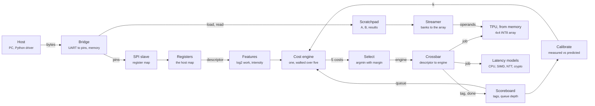
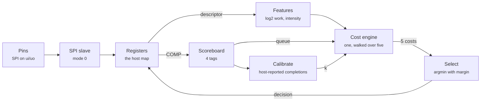

# HYDRA-130 architecture

Generated by `tools/gen_site.py`; `make site-check` proves it still matches the
repository. Three views, kept apart on purpose (SkyWater 130 audit, 2026-10-11):
what one named build contains, what exists as checked IP, and what is planned.

## As built: ecp5-evn-mem (scheduler + memory-fed array)

Every module below is instantiated in `plans/ecp5-evn-mem.yaml`'s own source list; the
generator checks it. The CPU, vector, NTT and crypto slots are latency models.

| block | file | module |
|---|---|---|
| Host | `tools/hydra_host.py` | `(software)` |
| Bridge | `fpga/rtl/hydra_fpga_bridge.sv` | `hydra_fpga_bridge` |
| SPI slave | `mom/rtl/hydra_tt_spi.sv` | `hydra_tt_spi` |
| Registers | `mom/rtl/hydra_tt_regs.sv` | `hydra_tt_regs` |
| Features | `mom/rtl/mom_features.sv` | `mom_features` |
| Cost engine | `mom/rtl/mom_cost_engine.sv` | `mom_cost_engine` |
| Select | `mom/rtl/mom_select.sv` | `mom_select` |
| Scoreboard | `mom/rtl/mom_scoreboard.sv` | `mom_scoreboard` |
| Calibrate | `mom/rtl/mom_calibrate.sv` | `mom_calibrate` |
| Crossbar | `common/rtl/mom_xbar.sv` | `mom_xbar` |
| TPU, from memory | `sys/rtl/hydra_engine_tpu_dma.sv` | `hydra_engine_tpu_dma` |
| Latency models | `sys/rtl/hydra_sys_tile.sv` | `hydra_sys_tile` |
| Streamer | `mem/rtl/hydra_dma_gemm.sv` | `hydra_dma_gemm` |
| Scratchpad | `mem/rtl/hydra_spram.sv` | `hydra_spram` |

## As built: the Tiny Tapeout tile (scheduler only)

| block | file | module |
|---|---|---|
| Pins | `tt/tile/src/tt_um_hydra_mom.sv` | `(software)` |
| SPI slave | `tt/tile/src/rtl/hydra_tt_spi.sv` | `hydra_tt_spi` |
| Registers | `tt/tile/src/rtl/hydra_tt_regs.sv` | `hydra_tt_regs` |
| Features | `tt/tile/src/rtl/mom_features.sv` | `mom_features` |
| Cost engine | `tt/tile/src/rtl/mom_cost_engine.sv` | `mom_cost_engine` |
| Select | `tt/tile/src/rtl/mom_select.sv` | `mom_select` |
| Scoreboard | `tt/tile/src/rtl/mom_scoreboard.sv` | `mom_scoreboard` |
| Calibrate | `tt/tile/src/rtl/mom_calibrate.sv` | `mom_calibrate` |

## IP library: built and checked, not all connected

| block | what | file | check |
|---|---|---|---|
| TPU array | 4x4 INT8 systolic array | `engines/tpu/rtl/tpu_top.sv` | `make tpu` |
| Vector unit | 4 x 32-bit lanes (not a GPU) | `engines/simd/rtl/simd_top.sv` | `make simd` |
| NTT | 4 Barrett butterflies, 3 moduli | `engines/ntt/rtl/ntt_top.sv` | `make ntt-moduli` |
| Vector unit, from memory | streamer and banks | `sys/rtl/hydra_engine_simd_dma.sv` | `make dma-simd` |
| NTT, from memory | memory format v1 | `sys/rtl/hydra_engine_ntt_dma.sv` | `make dma-ntt` |
| Test port | IEEE 1149.1 TAP, own clock | `dbg/rtl/hydra_jtag_tap.sv` | `make jtag` |
| Clock crossing | test port into the register map | `dbg/rtl/hydra_jtag_bridge.sv` | `make jtag-bridge` |
| Key vault | write and use, never read back | `sec/rtl/hydra_key_vault.sv` | `make keyvault` |
| Mailbox | lock, command, execute | `sec/rtl/hydra_mailbox.sv` | `make mailbox` |
| SHA-256 | padded in hardware | `sec/rtl/hydra_sha256_stream.sv` | `make sha256-stream` |
| Measurement | extend-only register | `sec/rtl/hydra_pcr.sv` | `make pcr` |
| Security ISA | Zknh + Xhydrasec unit | `isa/rtl/hydra_xsec_unit.sv` | `make xsec` |
| Pad multiplexer | OpenFrame pad ownership | `common/rtl/hydra_padmux.sv` | `make padmux` |

## Roadmap: specified, not built

| item | what | specification |
|---|---|---|
| CPU | Sixfold RV64, needs a program-load port | [docs/architecture/heterogeneous-system.md](architecture/heterogeneous-system.md) |
| GPU | Pixelstorm SIMT, sixth dispatch slot | [docs/architecture/heterogeneous-system.md](architecture/heterogeneous-system.md) |
| FHE profile | BFV via pinned OpenFHE, leveled | [docs/security/fhe-profile.md](security/fhe-profile.md) |
| SE boundary | authenticated, zeroised, access-checked | [docs/security/se-contract.md](security/se-contract.md) |
| Mode transition | QUIESCE, DRAIN, ZEROIZE, INSTALL | [docs/security/mode-transition.md](security/mode-transition.md) |
